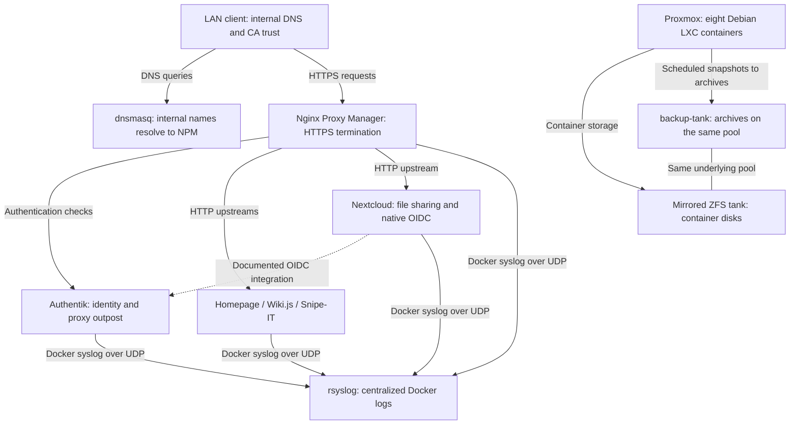

# VTMN Hub Infrastructure

A self-hosted collaboration platform and practical infrastructure lab built around Proxmox, Debian Linux containers, Docker, and centralized identity.

> **Availability as of October 22, 2026:** The physical Proxmox server is powered off. This README describes repository configurations and historical documentation; it does not establish that any service is currently running. No live infrastructure access was used for this review.

## Project overview

VTMN Hub brings file sharing, documentation, asset inventory, and service navigation together behind internal DNS, HTTPS, and a central identity provider. Its modular design provides a practical environment for learning Linux administration, virtualization, networking, identity management, security architecture, container operations, and recovery.

This repository captures provisioning commands, service definitions, authentication blueprints, and operating procedures. It combines infrastructure as code with manual configuration steps; it is not a complete unattended deployment.

### Evidence and implementation status

| Status | What the repository supports |
|---|---|
| Configured in source | Eight LXC definitions, six Docker Compose stacks, gated identity examples/history, Nginx exports, dnsmasq, rsyslog, a guarded new-CA initializer, and a Proxmox backup-job script. Files establish intended configuration, not successful deployment. |
| Historically documented | The [infrastructure reference](docs/INFRASTRUCTURE.md), dated July 28, 2026, describes deployed services and reports a test restore with data integrity verified. These are historical reports, not independently reproduced results from this review. |
| Pending in existing documentation | Restrictive firewall enforcement, installed-version inventory before any approved upgrade, independent backup recovery, identity compatibility checks and additional client DNS/CA setup. |
| Currently unverified | Service availability, installed versions, applied identity policies, certificate validity, backup freshness, and recoverability of the powered-off environment. |

## Architecture overview

The provisioning script defines eight unprivileged Debian 12 LXC containers with root disks on the documented mirrored ZFS pool. It enables nesting and keyctl for the six Docker application containers. Separate setup scripts define DNS and syslog as directly installed Linux services. These are source definitions, not a current inventory of running containers.

The provisioning script assigns each LXC interface to the Proxmox `vmbr0` bridge using DHCP. The reference records a single private LAN; VLAN segmentation and enforced inter-service isolation are not represented in these files.



- **Access path:** dnsmasq resolves the internal domain to Nginx Proxy Manager (NPM). NPM terminates HTTPS using an internally issued wildcard certificate and forwards requests to application ports over HTTP.
- **Identity:** Authentik provides the documented Nextcloud OIDC integration and proxy authentication for Homepage, Wiki.js, and Snipe-IT. Wiki.js and Snipe-IT still require application accounts and permissions.
- **Persistence:** Docker bind mounts and named volumes retain application data. Nextcloud provides shared files through its application; no separate NFS or SMB storage service is represented.
- **Operations:** Docker log drivers send logs to a dedicated rsyslog container. Proxmox backup configuration targets all eight containers.

See the [infrastructure reference](docs/INFRASTRUCTURE.md) for container IDs, recorded addresses, resource details, and proxy routes.

## Technology stack

| Technology or service | Purpose | Role within VTMN Hub |
|---|---|---|
| Proxmox VE | Virtualization and host management | LXC provisioning, storage registration, and scheduled backups |
| Debian 12 / LXC | Linux service environments | Eight unprivileged containers; six configured for Docker nesting |
| Docker / Docker Compose | Application packaging | Six service stacks with persistent storage and syslog logging |
| Authentik | Identity management | OIDC providers, forward-auth providers, and embedded proxy outpost |
| Nextcloud | Shared file access | File collaboration with MariaDB and Redis; documented native OIDC |
| Wiki.js | Documentation | Wiki with PostgreSQL; documented forward-auth access |
| Snipe-IT | Asset management | Inventory with MariaDB and documented Operator permissions |
| Homepage | Service dashboard | Internal service links, resource widgets, and custom styling |
| Nginx Proxy Manager | Reverse proxy | Internal HTTPS entry point, routing, and Authentik authentication checks |
| dnsmasq | Internal DNS | Wildcard internal resolution and upstream DNS forwarding |
| rsyslog / logrotate | Log collection and retention | UDP/TCP receiver, host/program log paths, and daily rotation |
| ZFS | Redundant storage | Mirrored pool for LXC root disks and local backup archives |
| OpenSSL | Internal PKI | Root CA and wildcard certificate generation |
| Proxmox backup tooling | Recovery | Snapshot-mode archives, zstd compression, and retention configuration |

Image tags describe requested images, not installed versions. Several stacks use `latest` or other mutable tags.

## Security architecture

### Identity, authentication, and authorization

The documentation defines `owners` and `operators` groups and reserves Authentik's built-in administrator group for break-glass access. These group assignments and restrictions are documented procedures; their complete configuration is not exported here.

- **Nextcloud:** Inactive Authentik provider examples and historical callback entries are included; the intended canonical callback requires version-matched review. The documentation describes first-login provisioning through `user_oidc`; the application-side settings are not fully captured.
- **Homepage, Wiki.js, and Snipe-IT:** NPM checks requests against Authentik's embedded outpost before forwarding them. This authenticates access through the proxy; it does not automatically create application identities or enforce application permissions.
- **Application permissions:** The [permission guide](scripts/configure-app-permissions.md) describes restricted Operator access. The intended restricted capabilities require per-version application setup and positive/negative tests; source guidance is not proof of effective user permissions.
- **MFA:** The [onboarding template](docs/ONBOARDING-TEMPLATE.md) asks for 2FA enrollment checks. The repository does not establish enforced MFA policies.

### Network access and HTTPS

The deployment is documented as LAN-only on an internal domain. Internal DNS and CA trust must be configured on each client or distributed through appropriate local network administration.

The [certificate script](scripts/create-internal-ca.sh) generates a root CA and wildcard server certificate for upload to NPM. HTTPS protects the client-to-proxy connection; the committed upstream routes use HTTP. A port named `8443` does not imply TLS: Nextcloud maps that host port to container port 80.

The [Proxmox firewall guide](proxmox/firewall-setup.md) explicitly records default ACCEPT policies. Restrictive enforcement remains pending. Published backend ports are not bound only to loopback, and the repository does not demonstrate rules preventing clients from bypassing proxy authentication through direct backend access.

### Secrets and administrative boundaries

[.env.example](.env.example) contains empty variables for database, application, and OIDC secrets. [.gitignore](.gitignore) excludes environment files and common private-key formats. No populated credentials or private-key files were identified in the 40 files reviewed at the source revision below. This is not a full Git history secret scan.

Real credentials, CA private keys, populated onboarding records, and recovery links belong outside version control. Historical Authentik placeholders are preserved outside discovery; inactive candidates require installed-version validation. Compose input guards reject missing/empty base inputs but do not render separately mounted blueprints or validate credential strength.

Homepage still mounts the Docker socket read-only in this integrated candidate. That flag does not restrict Docker API authorization. The prior removal proposal is deferred until actual external configuration and consumers are inventoried; see the [Homepage capability gate](services/homepage/README.md).

### Logging and accountability

All six application stacks configure Docker syslog logging to the dedicated receiver over UDP port 514. The receiver also accepts TCP and organizes logs by hostname and program. The setup script restricts the log directory and configures daily rotation with 30 retained rotations.

Owner-only access is documented, but immutable storage, authenticated/encrypted log transport, SIEM alerting, and complete host/security audit coverage are not established by these files. Centralized collection alone does not prove tamper resistance.

## Backup and recovery

The [backup job](proxmox/backup-job.sh) defines daily 02:00 snapshot-mode backups for containers 101–108, with zstd compression and retention of seven daily and four weekly restore points. The timezone of that schedule depends on the Proxmox host.

[Storage documentation](proxmox/storage-setup.md) places `backup-tank` at `/tank/backups` on the same mirrored pool used for container disks. The mirror provides disk redundancy; these local archives do not provide independent protection against loss of the host or pool. No off-host backup target is configured in the reviewed files.

The infrastructure reference reports a successful historical test restore, but includes no dated restore transcript or automated recovery test. The backup script recommends periodic restores to a separate container ID with a fresh network identity. Current backup contents, application consistency, and recovery times cannot be verified while the server is unavailable.

## Repository layout

```text
docs/                   Architecture reference and Operator onboarding template
proxmox/                LXC creation, ZFS storage, backup job, and firewall guidance
scripts/                Internal CA, DNS, syslog, and application permission setup
services/
  authentik/            Compose stack, empty discovery directory, inactive candidates/history
  dns/                  dnsmasq configuration
  homepage/             Dashboard Compose stack and configuration
  nextcloud/            Nextcloud, MariaDB, and Redis
  npm/                  Reverse proxy stack, notes, and exported Nginx configurations
  snipeit/              Snipe-IT and MariaDB
  syslog/               rsyslog receiver configuration
  wikijs/               Wiki.js and PostgreSQL
.env.example            Required secret variable names
```

Homepage's Kubernetes and Proxmox integration files contain sample/commented configuration. They are not evidence of deployed Kubernetes or an active Proxmox API integration.

## Rebuild workflow

These are planning steps for a future rebuild, not instructions to execute against the unavailable server. Resolve the configuration gaps below before treating the repository as reproducible.

> **Operational documentation warning:** Some linked documents retain unresolved historical instructions and assumptions, including blueprint loading, application account setup, and NPM configuration placement. Read them alongside the known limitations below; they are not yet a fully validated rebuild procedure.

1. Review the [storage procedure](proxmox/storage-setup.md) and adapt disk identifiers, template version, network settings, and container IDs to the target host. Storage creation requires deliberate disk selection.
2. Review [LXC provisioning](proxmox/create-containers.sh). It creates DNS first and pauses for configuration. Reconcile the fixed backend addresses in service files and install Docker in the six application containers. Set up [centralized logging](scripts/setup-syslog.sh) early to capture initial application events. A running remote UDP syslog receiver is not a universal prerequisite for creating application containers; logger initialization, networking, and log delivery still need separate verification.
3. Place populated `.env` files in the relevant service directories using [.env.example](.env.example). Generate secrets in the format required by each application and keep them outside Git.
4. Copy Homepage configuration to the Compose bind-mount location, and create NPM's external `proxy` Docker network as described in its [README](services/npm/README.md).
5. Preserve existing CA identity, keys and client trust. The [initializer](docs/INTERNAL-CA.md) is for a genuinely new CA and refuses existing output; it is not renewal or recovery. Review DNS client settings and NPM certificates/routes. Review exported Nginx files by context: they include full `map` and `server` blocks and should not be pasted wholesale into a proxy host's Advanced field. Read the [NPM context guide](services/npm/README.md) and [application operations](docs/APPLICATION-OPERATIONS.md) for missing auth/drive routes, Nextcloud trusted domains/proxies/OIDC and background jobs.
6. Inventory installed Authentik and stored blueprint/outpost state before promoting any [inactive candidate](services/authentik/README.md). Preserve actual credentials and existing app keys; do not activate historical files or infer policies from group names. Complete version-matched app/OIDC/local-account setup and verify permissions.
7. Configure the backup job and verify log collection, then perform an isolated restore test when infrastructure is available. Plan firewall enforcement with confirmed console access as the firewall guide requires.

## Known limitations and configuration gaps

| Area | Evidence and implication |
|---|---|
| Address stability | LXC creation uses DHCP; DNS, proxy providers, and log destinations embed recorded IPs. No DHCP reservations are captured. Reconcile addresses before deployment. |
| Nextcloud hostname | Compose trusted domains omit `drive.vtmn.internal`, although it is the documented proxy/OIDC hostname. Application-side trusted proxy and OIDC configuration is incomplete in source. |
| Authentik blueprint discovery | The candidate intentionally keeps project YAML out of the mounted blueprints/local directory. Installed discovery/instance behavior must be inventoried before any promotion. |
| Competing identity blueprints | Historical transitions are retained outside discovery; inactive examples consolidate intended assignments. Stored providers/outposts and unrelated memberships remain unverified. |
| Wiki.js permissions | The local-account/forward-auth procedure is reconciled in source; effective strategies, guest access, groups and permissions need live allow/deny tests. |
| NPM configuration format | The guide now distinguishes complete historical exports from Advanced content; auth/drive exports, actual host objects and generated configuration still need inventory. |
| Container feature description | Documentation now matches source: only the six Docker application guests define nesting/keyctl; effective guest settings remain unverified. |
| Version maintenance | Documentation records a pending Authentik upgrade; mutable image tags do not identify the historically installed version or a tested upgrade target. |
| Client onboarding | Existing documentation says DNS and CA trust were configured only on the Owner's device. Broader client readiness is unverified. |
| Recovery independence | Backups share the production ZFS pool; off-host copies and measured recovery objectives are not documented. |

## Integrated candidate and planning guides

This local review candidate combines the earlier source proposals and documentation without merging PR #1 or applying changes to the server. Homepage's socket removal is deliberately deferred. Proposed network enforcement, independent backups, monitoring, image changes and GitHub protections are not configured.

See [network security](docs/NETWORK-SECURITY-PLAN.md), [backup/recovery](docs/BACKUP-RECOVERY-PLAN.md), [version management](docs/VERSION-MANAGEMENT.md), [logging/monitoring](docs/LOGGING-MONITORING-PLAN.md), [script safety](proxmox/SCRIPT-SAFETY.md), [GitHub governance](docs/GITHUB-GOVERNANCE.md) and [portfolio evidence](docs/PORTFOLIO-EVIDENCE.md). Resolve compatibility and recovery prerequisites before proposing deployment.

## Practical experience represented

The repository provides concrete examples of:

- **Virtualization and Linux administration:** resource allocation, unprivileged LXC provisioning, package installation, and systemd service configuration.
- **Networking and PKI:** bridged networking, internal DNS forwarding, reverse proxy routing, CA issuance, and client trust requirements.
- **Identity and access management:** OIDC and forward-auth integration, local application permissions, and Operator onboarding procedures.
- **Container and infrastructure management:** Compose dependencies, persistent data, service configuration, ZFS storage, and backup scheduling.
- **Security operations:** centralized logging, recovery planning, and identifying the limits of permissive firewall policies and proxy-only authentication.

These artifacts demonstrate implementation work and documented design decisions without claiming production hardening, availability, or complete automation.

---

**Review basis:** Infrastructure baseline revision `14eb27fafb4c43d49595a065daf91ce68d8c13cd`; PR #1 README foundation at 761c73b4afd6c4d2c6f4ecd7e13f34feb8d85267; locally integrated October 22, 2026. Original baseline audit covered 40 files; added source proposals receive separate offline checks, not a new live audit. No server, internal address, or service endpoint was contacted.
